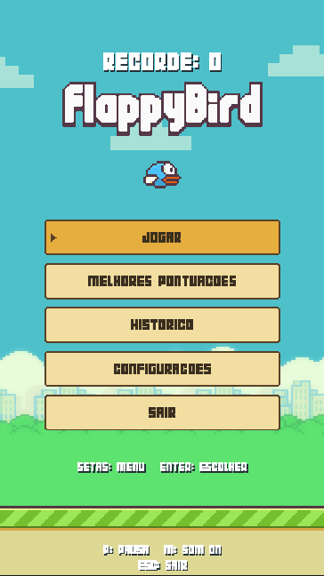
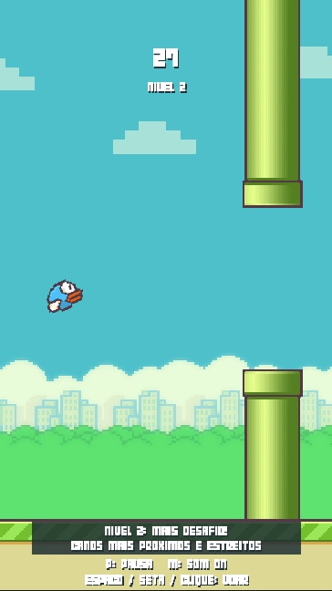
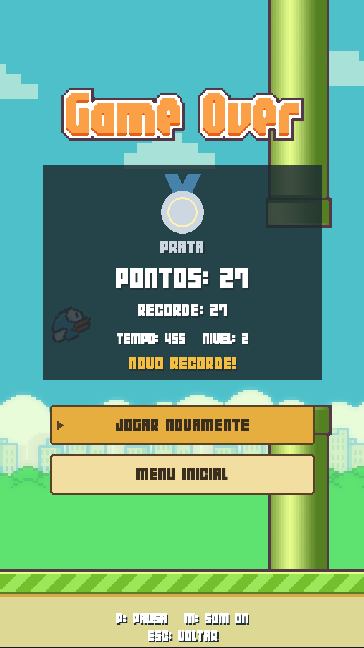

# Flappy Bird

Jogo de estudo desenvolvido em **Python e Pygame**, inspirado em Flappy Bird. Desvie dos canos, supere seu recorde e enfrente uma dificuldade que aumenta a cada 25 pontos.

O projeto inclui menu, histórico local, configurações persistentes e um instalador para Windows que permite jogar sem instalar Python.

## Veja o jogo

<table>
  <tr>
    <th>Menu inicial</th>
    <th>Partida</th>
    <th>Resultado</th>
  </tr>
  <tr>
    <td></td>
    <td></td>
    <td></td>
  </tr>
</table>

Capturas do jogo com dados de demonstração.

## Jogar no Windows

1. Baixe [FlappyBird-Setup.exe](releases/FlappyBird-Setup.exe), disponível na pasta `releases/` do projeto.
2. Execute o instalador e siga as instruções. O atalho na área de trabalho é opcional.
3. Abra **Flappy Bird** pelo menu Iniciar e selecione **Jogar**.

O instalador é destinado ao **Windows 10/11 de 64 bits**. Inclui o jogo, suas dependências e um desinstalador. Não exige Python nem conexão com a internet para jogar.

## Recursos

- **Dificuldade progressiva:** velocidade maior e canos mais próximos e estreitos a cada 25 pontos, até o nível 6. Os canos já na tela preservam sua abertura.
- **Início e retomada com contagem:** três segundos de preparação, sem avançar a física ou o tempo da partida.
- **Pausa automática:** o jogo pausa ao perder o foco da janela.
- **Recorde e Top 5 locais:** as melhores pontuações permanecem disponíveis mesmo após sair do histórico recente.
- **Histórico:** últimas 20 partidas, com data, duração, nível, média de pontos e indicação de partidas interrompidas.
- **Medalhas e novo recorde:** reconhecimento da pontuação na tela de resultado.
- **Configurações salvas:** volume, som e modo de tela.
- **Visual pixel art:** pássaro animado, cenário em movimento e nuvens, mantendo o estilo original.
- **Janela redimensionável:** proporção do jogo preservada, com faixas nas laterais quando necessário.

| Medalha | Pontuação mínima |
| --- | ---: |
| Bronze | 10 |
| Prata | 25 |
| Ouro | 50 |
| Platina | 100 |

## Controles

| Ação | Controle |
| --- | --- |
| Voar | Espaço, seta para cima ou clique esquerdo |
| Navegar nos menus | Setas para cima/baixo ou mouse |
| Confirmar opção | Enter, Espaço ou clique esquerdo |
| Pausar / retomar | P; Esc durante a partida ou a pausa |
| Alternar som | M |
| Alternar tela cheia | F11; pausa a partida em andamento |
| Mudar página do histórico | Setas esquerda/direita ou botões da tela |
| Voltar ao menu | Esc nas telas de consulta, configurações e resultado |
| Sair | Opção Sair ou Esc no menu inicial |

## Executar pelo código

Ambiente validado: **Python 3.12 de 64 bits** e **Pygame 2.6.1**. No PowerShell, dentro da pasta do projeto:

```powershell
py -3.12 -m venv .venv
.\.venv\Scripts\python.exe -m pip install -r requirements.txt
.\.venv\Scripts\python.exe main.py
```

Se o ambiente `.venv` já estiver preparado, execute apenas o último comando. O Python 3.12 precisa estar instalado para criar esse ambiente. Use essa versão para reproduzir o ambiente testado.

## Dados locais

Os dados ficam separados da instalação:

```text
%LOCALAPPDATA%\AdrianoGames\FlappyBird\
├── profile.json     # Recorde, Top 5 e últimas 20 partidas
└── settings.json    # Volume, som e tela cheia
```

A desinstalação preserva esses arquivos. Pontuações e configurações pertencem ao perfil local do Windows; não há ranking online. Ao executar o código, um recorde antigo em `data/record.json` é aproveitado se ainda não existir o novo perfil.

## Estrutura

```text
flappy-bird/
├── main.py                  # Telas, eventos, física e dificuldade
├── storage.py               # Leitura, validação e gravação dos dados
├── assets/                  # Sprites e fonte pixel art
├── sound/                   # Efeitos sonoros
├── tests/                   # Testes automatizados
├── docs/images/             # Capturas usadas neste README
├── installer/game.iss       # Configuração do Inno Setup
├── build.py                 # Geração do executável e instalador
├── requirements.txt         # Dependência do jogo
├── requirements-build.txt   # Ferramentas de empacotamento
├── releases/                # Instalador pronto para distribuição
└── BUILD.md                 # Instruções de compilação e diagnóstico
```

`.venv/`, `build/`, `dist/` e dados legados em `data/` são ignorados pelo Git. A pasta `releases/` contém o instalador que acompanha o projeto.

## Testes e distribuição

```powershell
.\.venv\Scripts\python.exe -m unittest discover -s tests -v
```

Os testes cobrem colisões, pontuação, movimento, dificuldade, contagem, pausa, navegação, persistência e tratamento de falhas de gravação.

Para gerar o EXE, recompilar o instalador ou conferir o pacote, consulte [BUILD.md](BUILD.md). A distribuição usa **PyInstaller** e **Inno Setup**. O executável portátil é gerado em `dist/FlappyBird.exe`, e o instalador em `releases/FlappyBird-Setup.exe`.
